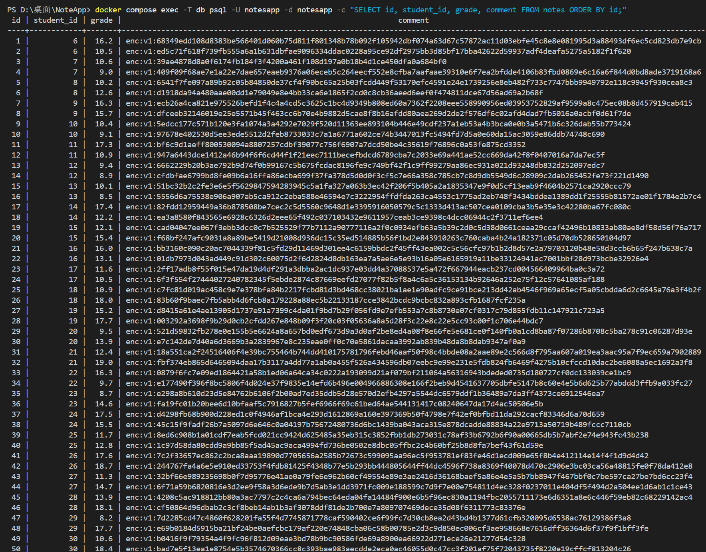
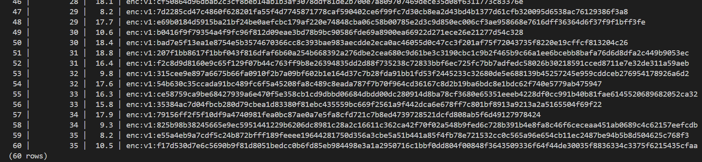
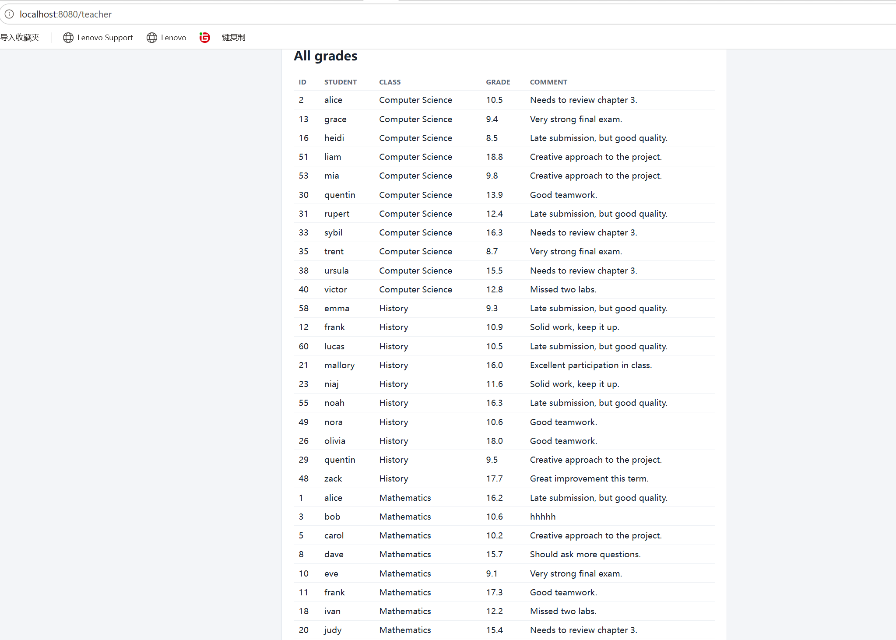
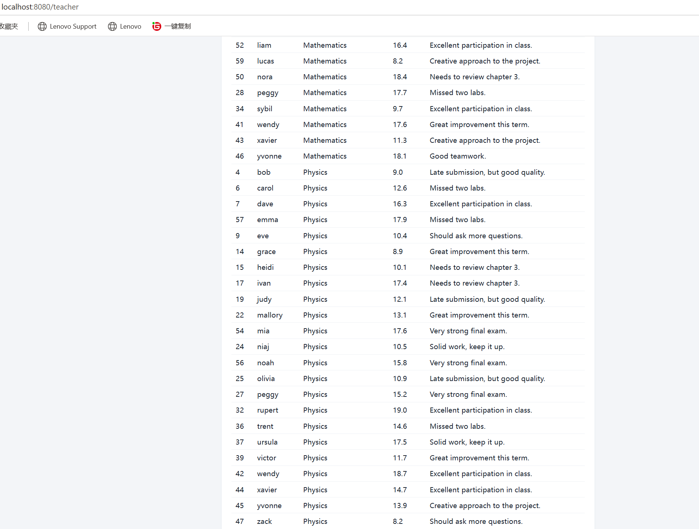
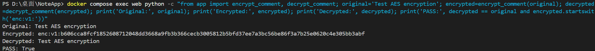

# Session 03 Homework: AES-GCM Encryption
**Student:** Bian Hongrui

---

## 1. Implementation Summary

For this assignment, I implemented AES-256-GCM symmetric encryption to protect the `comment` column in the NotesApp database. The solution ensures that a stolen database is useless without the encryption key.

### Key Features:
*   **Encryption Logic**: When a teacher adds or updates a grade, the comment is encrypted using a randomly generated 12-byte nonce. The output (`nonce + ciphertext`) is hex-encoded and stored with an `enc:v1:` prefix.
*   **Decryption Logic**: When a student or teacher views the dashboard, the application detects the prefix, extracts the nonce, and decrypts the data back to plaintext.
*   **Data Migration**: A startup migration script safely converts all historical plaintext comments into ciphertext.
*   **Concurrency Control**: The migration uses PostgreSQL advisory locks (`pg_try_advisory_lock`) to prevent multiple Gunicorn workers from encrypting the same data simultaneously.
*   **Idempotency**: The script checks for existing `enc:` prefixes to prevent double-encryption, ensuring that restarts do not corrupt existing data.

---

## 2. Validation Evidence

### 2.1 Database Ciphertext Verification
All 60 comments in the database are encrypted and stored as `enc:v1:...` ciphertext. A stolen copy of the database contains no readable student comments.




### 2.2 Web Interface Decryption Verification
The application successfully decrypts the data on the fly. The Teacher Dashboard shows normal plaintext comments without any data loss or corruption.




### 2.3 Idempotent Migration Log
The application startup log confirms that the migration logic is idempotent. It detects that all 60 records are already encrypted and skips them, preventing double-encryption.


### 2.4 Unit Test for Cryptography Functions
A direct Python unit test executed inside the Docker container proves that the `encrypt_comment()` and `decrypt_comment()` functions are logically sound.



---

## 3. How to Run

1. Configure the environment variables in your `.env` file:
   ```env
   COMMENT_ENCRYPTION_KEY=your_32_byte_hex_or_base64_key_here
   HMAC_SECRET=your_hmac_secret_here
   ```
2. Start the Docker containers:
   ```bash
   docker compose up -d --build
   ```
3. Access the application at `http://localhost:8080`.

---