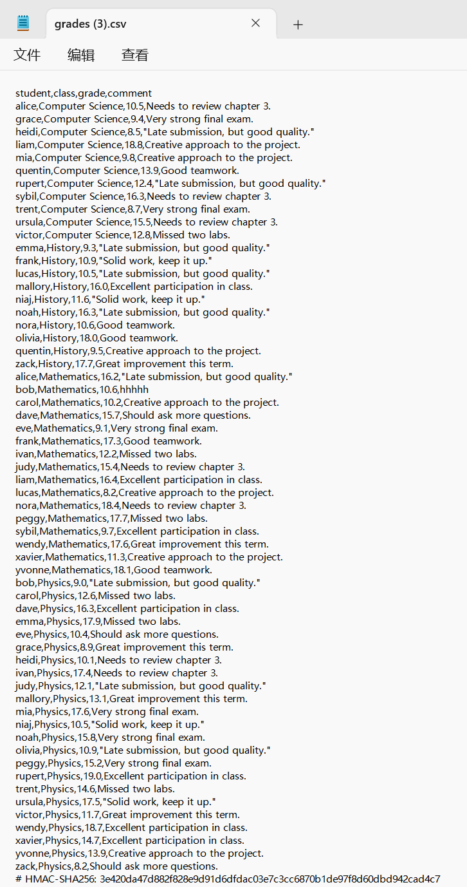
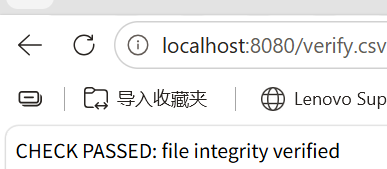
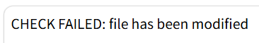
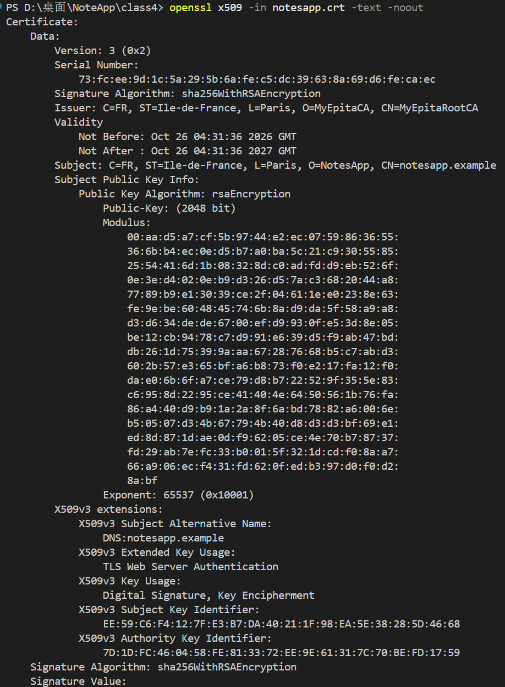
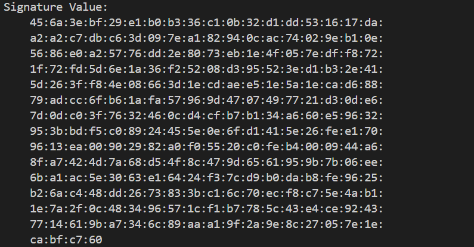
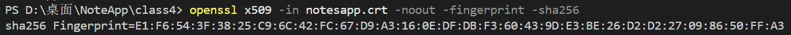

# Session 04 Homework: Hashing, Integrity & Asymmetric Encryption
**Student:** Bian Hongrui

---

## 1. Implementation & Verification Summary

This assignment focused on ensuring data integrity (Hashing & HMAC) and implementing Asymmetric Encryption (PKI & Certificates).

### 1.1 HMAC Integrity Verification (NotesApp)
The NotesApp application uses HMAC-SHA256 to sign exported CSV files. 
*   The server calculates the HMAC of the CSV content using a shared secret key (`HMAC_SECRET`) and appends it as a comment at the end of the file.
*   When uploaded to `/verify.csv`, the server recalculates the HMAC. If a single character is modified, the HMAC mismatch is detected, proving the file's integrity and authenticity between the two parties.

### 1.2 Asymmetric Encryption & Certificates (OpenSSL)
To understand PKI (Public Key Infrastructure) and digital signatures, I acted as a Certificate Authority (CA) using OpenSSL:
1. Generated a Root CA private key and a self-signed Root CA certificate.
2. Generated a private key and Certificate Signing Request (CSR) for `notesapp.example`.
3. Issued an X.509 certificate signed by my Root CA.
4. Verified the certificate details, extracted its SHA-256 fingerprint, and inspected the signature block.

---

## 2. Validation Evidence

### 2.1 HMAC Signature & Verification
The CSV file ends with a `# HMAC-SHA256:` signature to prevent tampering.
*   **Figure 1:** Signed CSV export showing the appended HMAC.
*   **Figure 2:** The original, unmodified file passes verification (`CHECK PASSED`).
*   **Figure 3:** A modified file (changing a grade) fails verification (`CHECK FAILED`).

### 2.2 X.509 Certificate Inspection
I created a self-signed Root CA (`MyEpitaRootCA`) and issued a certificate for `notesapp.example`. 

*   **Figure 4a:** The OpenSSL output shows the Issuer (CA), Subject (NotesApp), Public Key (RSA 2048-bit), and the Signature Algorithm.
*   **Figure 4b:** The certificate's RSA signature value, generated by the Root CA to support certificate authenticity and integrity verification.
*   **Figure 5:** The SHA-256 fingerprint of the certificate, which provides a compact and unique way to identify it.

---

## 3. Conclusion

By appending an HMAC-SHA256 value to exported CSV files, NotesApp can detect unauthorized modifications when the file is verified using the same secret key. The OpenSSL experiment demonstrates how a Root Certificate Authority can issue an X.509 certificate to associate a public key with an identity. The SHA-256 fingerprint provides a compact way to identify the certificate. Together, these techniques illustrate the importance of data integrity, message authentication, and public key infrastructure in computer security.