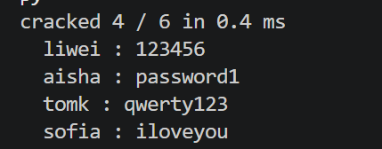
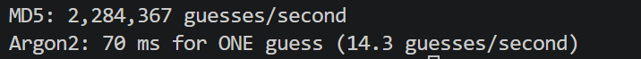
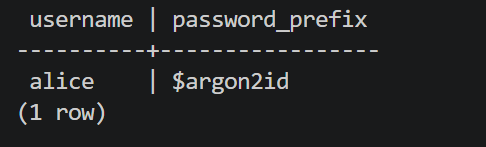

# NotesApp Password Audit

**Names:** Katie Guo and Hongrui Bian

## Finding 1 — Unsalted MD5

We cracked 4 out of 6 accounts in 0.4 ms using the public wordlist.

The cracked accounts were liwei, aisha, tomk and sofia.
`marie` and `raj` were not cracked because their passwords were not in this wordlist (marie used a predictable pattern `username+pw`, and raj used a completely random strong password).

**Severity:** High, because 4 out of 6 accounts were cracked in only 0.4 ms. If the password database is stolen, attackers can guess common passwords very quickly.

**Fix:** Use Argon2 with a random salt to store passwords.

## Finding 2 — Speed comparison

| Hash | Guesses per second | Estimated guesses per day |
|---|---:|---:|
| MD5 | 2,284,367 | 197,369,308,800 |
| Argon2 | 14.3 | 1,235,520 |

Argon2 took about 70 ms for one hash.
In our test, Argon2 was about 160,000 times slower per guess than MD5.

**Verdict:** MD5 allows attackers to try many passwords very quickly. Argon2 makes each guess much slower, so a large attack takes more time and resources. Weak passwords can still be guessed.

## Application check

Alice's password was upgraded to Argon2id after a successful login.
We logged out and logged in again successfully.
Other old accounts will upgrade when they next log in successfully.

