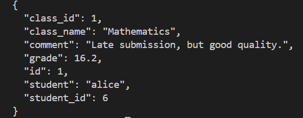

# Class 6: JWT Forgery and IDOR Exploit

## Task: Forge a Token
The objective was to bypass authentication and read a grade belonging to another user without knowing their password.

## Vulnerability Exploited
1. **JWT `alg: none` Bypass:** The backend accepts unsigned JWTs if the header specifies `"alg": "none"`.
2. **IDOR (Insecure Direct Object Reference):** The `/api/notes/<id>` endpoint does not check if the authenticated user owns the note.

## Exploit Proof
I forged a JWT claiming to be a teacher (`role: teacher`) with no signature. Using `curl`, I sent this token to read Alice's grade.

