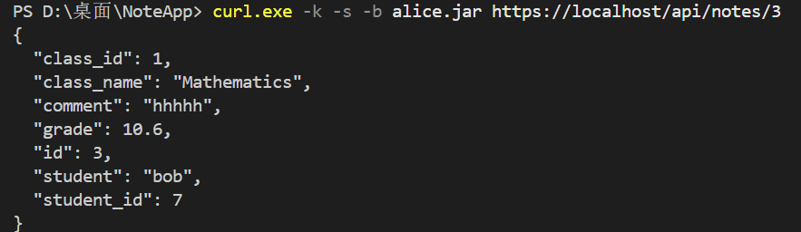
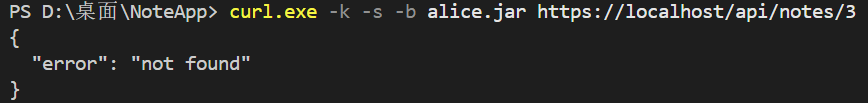
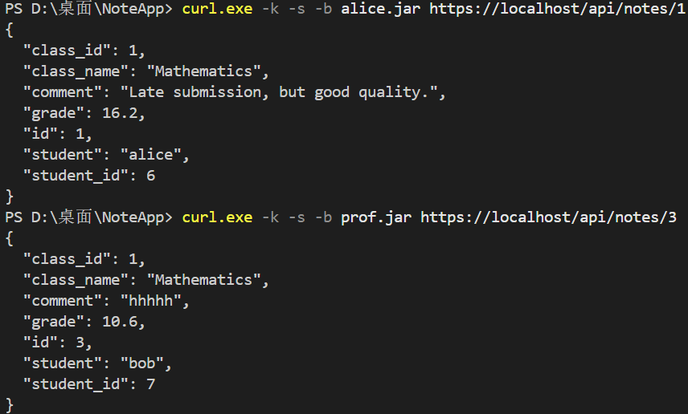

# Class 8 — IDOR Fix

## Task

The goal was to find and fix an IDOR vulnerability in NotesApp.

## Before the Fix

I logged in as Alice and requested `/api/notes/3`.

The API returned Bob's Mathematics grade (10.6) and comment, even though I was logged in as Alice.

## Fix

I updated the `api_notes` function in `web/app.py`.

Now students can only access their own grades. Teachers and admins can still access all grades.

If a student requests someone else's grade, the API returns `404 not found`.

## After the Fix

I tested the API again:

- Alice accessing Bob's grade: `not found`
- Alice accessing her own grade: 16.2
- Teacher accessing Bob's grade: 10.6

## Result

The IDOR vulnerability was fixed. Students can no longer read other students' grades, and normal access still works.