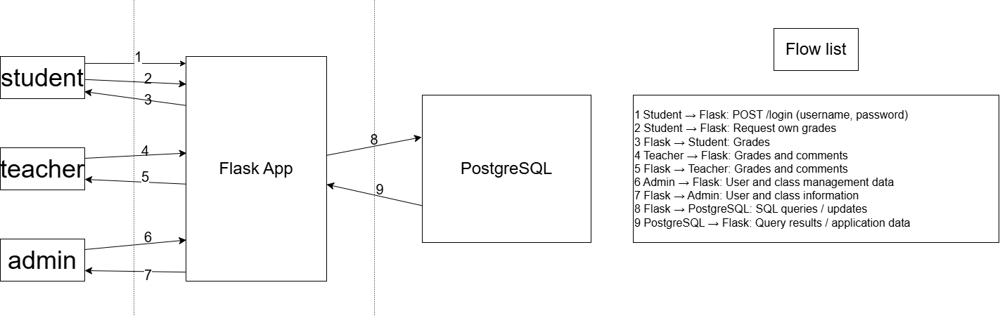
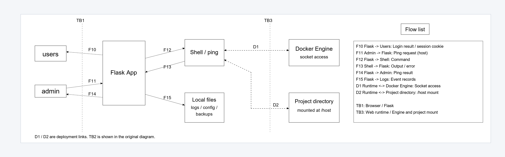

# Project 1: Threat Model of NotesApp

**Group members:** GUO KEXIN, BIAN HONGRUI, ZHANG XINYUE

## 1. Application and data flows

NotesApp is a small grades application built with Flask and PostgreSQL. Students read their own grades, teachers enter grades and comments for their classes, and administrators manage users and classes. We want to protect private student information, prevent unauthorized changes, and keep the application available.

This report extends our earlier data-flow diagram and STRIDE table. We also checked the application's source for login, ping and logging, and its Docker configuration. Some entries describe weaknesses visible in the code; others depend on deployment conditions. The scores are estimates, not results of attack or load tests. The report assesses the teaching application before the separate comment-encryption lab changes.

The two vertical dotted lines in our original diagram represent the trust boundaries:

- **TB1: browsers ↔ Flask (F1–F7), the left dotted line.** Requests come from user-controlled devices. Flask must check the session, permissions and input instead of trusting values sent by the browser.
- **TB2: Flask ↔ PostgreSQL (F8–F9), the right dotted line.** The database is a separate service with its own credentials and permissions. Flask should connect using a restricted application account. The connection also needs protection if it crosses an untrusted network.

**Within Flask, permissions must also separate the roles**: students should access only their own records, teachers should change records only in their assigned classes, and administrators manage users and classes. These are rules the server must enforce, not evidence that the current code enforces them.

The image keeps our original F1–F9 flows. F1 shows student login; the application uses the same login route for all roles. The original diagram summarises the core grade, user and database actions. The API and CSV export share the same browser/application/database crossings; they are not given one number per HTTP request here.

### Additional flows checked against the source

The supplementary diagram adds the login response, administrator ping operation and log writes without changing the original image or its numbering.

| Flow | Direction | Data |
|---|---|---|
| F10 | Flask → Browser | Login response: redirect and session cookie on success, or login form/error on failure |
| F11 | Administrator browser → Flask | Ping request containing a host value and session cookie |
| F12 | Flask → Shell/ping | Command built from the host value |
| F13 | Shell/ping → Flask | Standard output, error output or execution error |
| F14 | Flask → Administrator browser | Ping result displayed in the admin page |
| F15 | Flask → Local log file | Login, grade-write and ping events |

F10, F11 and F14 cross **TB1**. Flask, Shell and local files share the web container's execution privileges, so the supplement does not invent an isolation boundary between them. Static assets and the image's configuration/backup files are local resources, not separate external services.

**TB3 — web runtime ↔ Docker Engine control and mounted project files:** the Compose configuration mounts the Docker socket and the project directory into the web container. These links can give a compromised runtime access beyond its own container files.

| Link | Configured access | Security meaning |
|---|---|---|
| D1 | Web runtime ↔ Docker socket | Code execution may allow Docker Engine control if the socket is usable |
| D2 | Web runtime ↔ Project directory mounted at `/host` | Code execution may allow changes to files in that project directory |

D1 and D2 are deployment relationships, drawn as dashed links, rather than ordinary requests made by the ping feature. Their reach depends on the Docker deployment; the diagram does not imply access to every Windows host file. Local log, configuration and backup files also need restricted access.

Source checked: `web/app.py` (`login`, `api_notes`, `teacher`, `grades`, `admin_ping`, `log`), `web/Dockerfile` and `docker-compose.yml`. This checks code and configuration, not successful exploitation.

## 2. Risk scale

For each threat, we estimate likelihood (L) and impact (I) on a scale from 1 to 3.

| Value | Likelihood | Impact |
|---|---|---|
| 1 | Unlikely: needs unusual access or conditions | Minor: limited metadata exposure or brief disruption |
| 2 | Possible: needs a stolen session, network position or another precondition | Significant: limited private-data exposure or partial disruption |
| 3 | Likely: easy to repeat through an exposed function if its control is missing | Severe: unauthorized grade changes, broad data exposure or a major outage |

**Risk = L × I.** Scores 1–2 are Low, 3–4 are Medium, and 6–9 are High. These are relative priorities, not measured probabilities.

## 3. STRIDE table

S = Spoofing; T = Tampering; R = Repudiation; I = Information disclosure; D = Denial of service; E = Elevation of privilege.

We split the earlier table into individual threats so that each has its own score. Related threats can describe parts of the same attack; their scores should not be added together.

| Flow | STRIDE | Possible threat | L × I | Risk |
|---|---|---|---|---|
| F1 | S | Stolen credentials let an attacker log in as another user. | 2 × 3 = 6 | High |
| F1 | T, E | SQL injection in login input changes the query and bypasses authentication. | 3 × 3 = 9 | High |
| F1 | R | Login logs lack enough context and protection to reliably attribute account misuse. | 2 × 2 = 4 | Medium |
| F1 | I | Raw login query errors reveal database details. | 3 × 1 = 3 | Medium |
| F1 | D | Repeated login attempts consume server resources. | 3 × 2 = 6 | High |
| F2 | S | An attacker uses a stolen student session to request grades. | 2 × 3 = 6 | High |
| F2 | T, I | Changing a record identifier reveals other students' grades if ownership is not checked. | 3 × 3 = 9 | High |
| F2 | R | Without access logs, the application cannot trace who requested a record. | 2 × 2 = 4 | Medium |
| F2 | D | Repeated grade requests exhaust application resources. | 3 × 2 = 6 | High |
| F3 | T | A network attacker alters returned grades if transport protection is missing. | 2 × 2 = 4 | Medium |
| F3 | I | Unencrypted responses expose private grades. | 2 × 3 = 6 | High |
| F3 | D | An attacker on the network path blocks responses to students. | 2 × 2 = 4 | Medium |
| F4 | S | Stolen teacher credentials or a session allow teacher impersonation. | 2 × 3 = 6 | High |
| F4 | T | Unchecked grade or comment fields allow invalid records to be stored. | 3 × 3 = 9 | High |
| F4 | R | Grade-write logs lack before/after values, making disputed changes difficult to reconstruct. | 2 × 3 = 6 | High |
| F4 | I | Unencrypted requests expose grades, comments or session tokens. | 2 × 3 = 6 | High |
| F4 | D | Repeated writes consume resources or hold database locks. | 3 × 2 = 6 | High |
| F4 | E, T | A teacher changes another class's grades because class ownership is not checked. | 3 × 3 = 9 | High |
| F5 | T | A network attacker changes the data returned to a teacher. | 2 × 2 = 4 | Medium |
| F5 | I | Unencrypted teacher responses expose grades and comments. | 2 × 3 = 6 | High |
| F5 | D | Blocking responses prevents teachers from using the service. | 2 × 2 = 4 | Medium |
| F6 | S | Stolen administrator credentials or a session allow administrator impersonation. | 2 × 3 = 6 | High |
| F6 | T | Manipulated management fields change unintended user or class data. | 3 × 3 = 9 | High |
| F6 | R | Missing audit logs make administrator changes difficult to prove. | 2 × 3 = 6 | High |
| F6 | I | Unprotected management requests expose personal information. | 2 × 3 = 6 | High |
| F6 | D | Repeated management operations overload the application or database. | 2 × 3 = 6 | High |
| F6 | E | A lower-privileged user bypasses the administrator role check with a forged session; see the session-forgery threat below. | 3 × 3 = 9 | High |
| F7 | T | A network attacker alters returned user or class information. | 2 × 2 = 4 | Medium |
| F7 | I | Unencrypted responses disclose user and class information. | 2 × 3 = 6 | High |
| F7 | D | Blocking responses prevents administrator access. | 2 × 2 = 4 | Medium |
| F8 | S | Stolen database credentials let an attacker connect as the application. | 2 × 3 = 6 | High |
| F8 | T | Injected SQL modifies grades, users or class records. | 3 × 3 = 9 | High |
| F8 | R | Weak application and database logs make changes hard to trace to a user. | 2 × 2 = 4 | Medium |
| F8 | I | Injected or overbroad queries retrieve unauthorized private records. | 3 × 3 = 9 | High |
| F8 | D | Expensive queries or too many connections overload PostgreSQL. | 2 × 3 = 6 | High |
| F8 | E | SQL injection combined with excessive database privileges grants extra capabilities. | 2 × 3 = 6 | High |
| F9 | T | Modified database data or intercepted results cause Flask to use incorrect values. | 2 × 3 = 6 | High |
| F9 | I | Intercepted results disclose private grades or user data. | 2 × 3 = 6 | High |
| F9 | D | Database overload prevents query results from returning. | 2 × 3 = 6 | High |
| F10 and later authenticated requests | S, E | The published Flask signing key can allow an attacker to forge a session and submit requests as an administrator. | 3 × 3 = 9 | High |
| F11–F14 | T, E | An actor with an administrator session changes the host input to run unintended shell commands. | 2 × 3 = 6 | High |
| D1–D2 | T, E | Code execution in the web runtime may allow Docker Engine control or modification of the mounted project. | 2 × 3 = 6 | High |
| F15 | R, T | Incomplete or locally modifiable logs, and silently ignored write failures, undermine audit evidence. | 2 × 2 = 4 | Medium |
| F15 | D | Repeated log writes without rotation can consume available disk space. | 2 × 2 = 4 | Medium |
| Local files | I | Access to readable configuration or backup files exposes deployment secrets or account information. | 2 × 3 = 6 | High |

For network interception or modification, we assume the attacker is on the connection path and transport protection is missing. Database-overload likelihood is 2 because practical capacity was not measured; F8 and F9 may describe the same incident. The standalone ping threat assumes an administrator session. A forged administrator session can satisfy that prerequisite, linking it to the score-9 session-forgery risk. Docker/file access requires usable runtime access; local files are not assumed to be publicly downloadable. Related scores are not added together.

We changed the earlier F9 elevation-of-privilege entry to tampering: changing returned data does not automatically grant more permissions. It would also become privilege escalation if the application used a modified role value to grant administrator access. Cross-student access in F2 remains an authorization failure even though it does not give the attacker an administrator role.

## 4. Top three risks and fixes

All three priorities below score 9. We prioritise direct paths to private records and privileged operations seen in the source. Other high-risk entries, including unsafe input, shell execution and database overload, still need fixes.

### 1. Broken authorization — 9/9 (F2, F4)

An authenticated caller can request another student's API note by changing its identifier. A teacher can also read or change grades outside their assigned classes because ownership is not checked. The application has role checks, but those checks alone do not restrict which records a user can access.

**Fix:** check permissions on the server for every request. Use the identity from the session, restrict student reads to that student's records, check a teacher's assigned classes before allowing changes, and allow only administrators to manage users and classes. Hiding buttons in the interface is not enough.

A useful check is to log in as one student and request another student's record: no private data should be returned. A student request to change a grade or manage a user must also be rejected without changing the database.

### 2. SQL injection — 9/9 (F1, F8)

The login function inserts user input directly into SQL text. An attacker could change the meaning of that query and obtain another user's identity. Injection can also expose or modify records within the database account's permissions. This unsafe query construction was found in the source; successful exploitation was not tested.

**Fix:** use parameterized queries so values are treated as data. Give the application database account only the permissions it needs, without superuser or role-management privileges. Validate grade and comment fields as well; validation does not replace parameterization.

To check this, review how queries are built and test unusual input in a local test environment. It should be handled as a value, without bypassing login or changing unrelated records.

### 3. Forged administrator sessions — 9/9 (F10 and later authenticated requests)

The application uses a Flask session-signing key supplied in the source/configuration. An attacker who knows that key may create a session that the application accepts as an administrator. This is an authentication problem, separate from a logged-in student requesting another student's record.

**Fix:** generate a strong deployment-specific signing key outside source control, rotate the exposed key and invalidate sessions signed with it. Resolve current permissions from trusted server-side records and apply authorization checks to every sensitive operation.

Check that legitimate new sessions work and sessions signed with the old key are rejected. Also verify that account revocation and role changes take effect; changing a role value in a request must not grant access.

A forged administrator session may also reach the unsafe ping tool. Fix that path separately: avoid `shell=True`, validate the destination and pass fixed executable arguments. Remove the Docker socket and broad project mount from the web container and run it with limited privileges. These measures limit the consequences of an identity or code-execution failure.

## 5. Other controls

Use HTTPS for client connections, protect session cookies and expire inactive sessions. For availability, limit repeated requests, paginate large results, bound database connections, apply query timeouts and rotate logs. Validate grades against the allowed range and handle comments safely when displaying them. Keep protected logs of login attempts and grade, user and class changes, without recording passwords or session tokens. These controls address the remaining STRIDE entries.

## References

- [OWASP: Authorization Cheat Sheet](https://cheatsheetseries.owasp.org/cheatsheets/Authorization_Cheat_Sheet.html)
- [OWASP: SQL Injection Prevention Cheat Sheet](https://cheatsheetseries.owasp.org/cheatsheets/SQL_Injection_Prevention_Cheat_Sheet.html)
